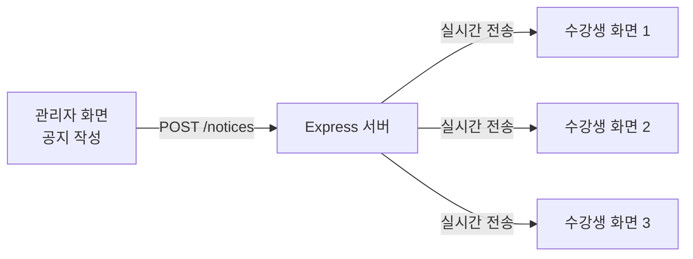
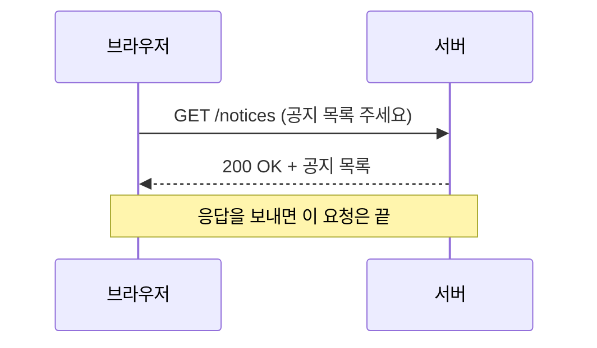
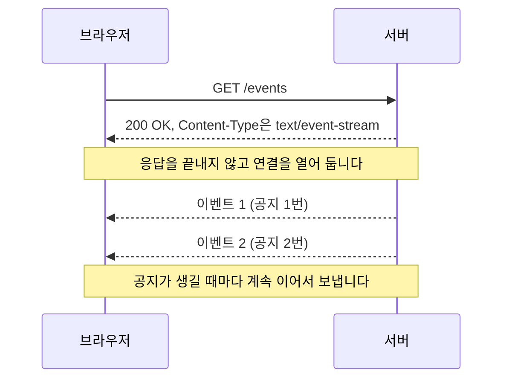
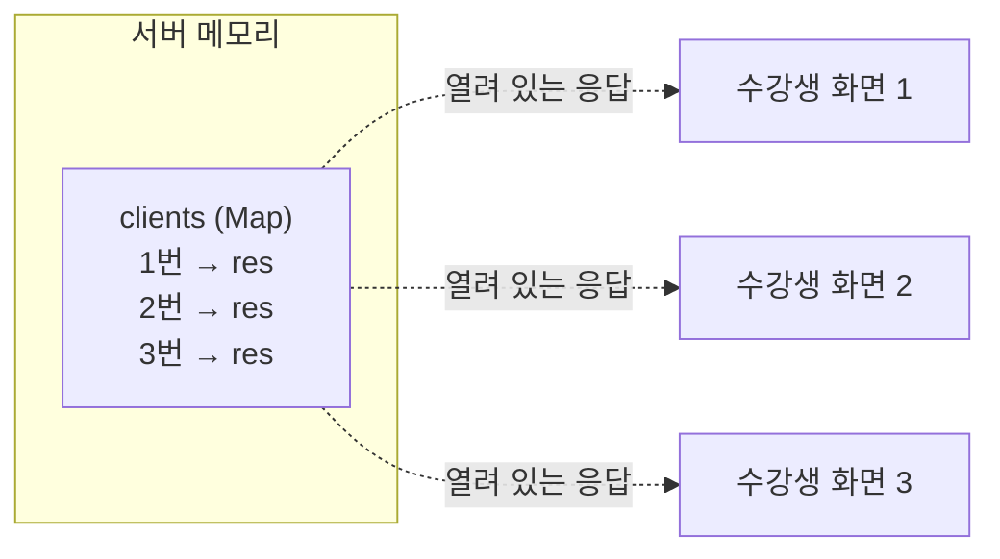
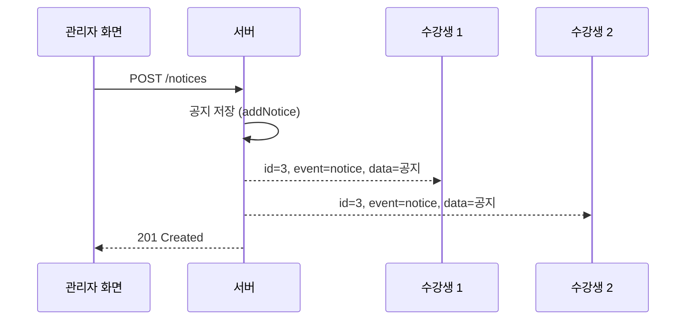
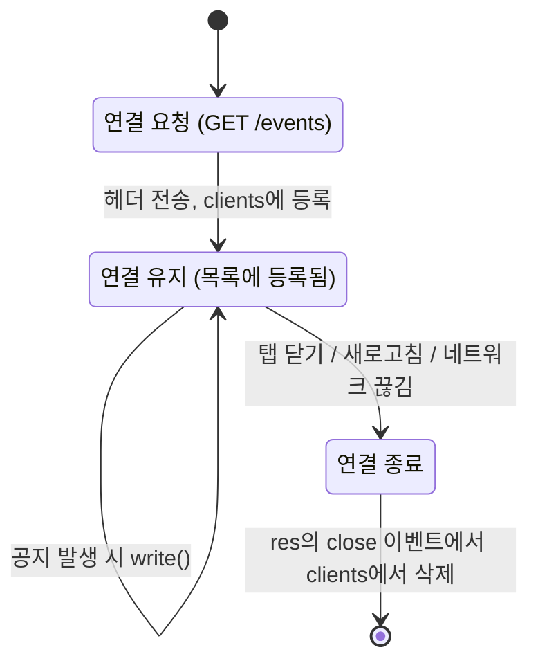
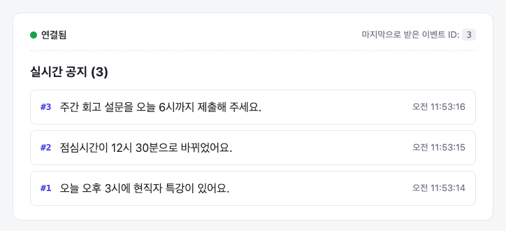
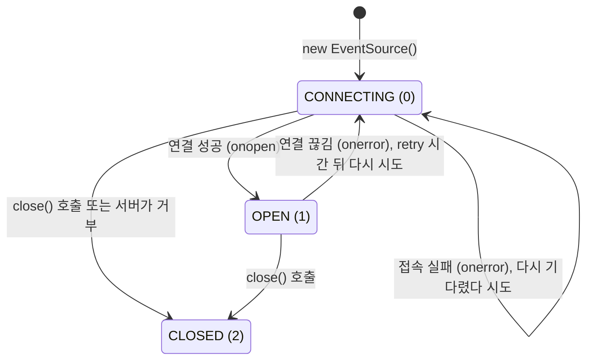
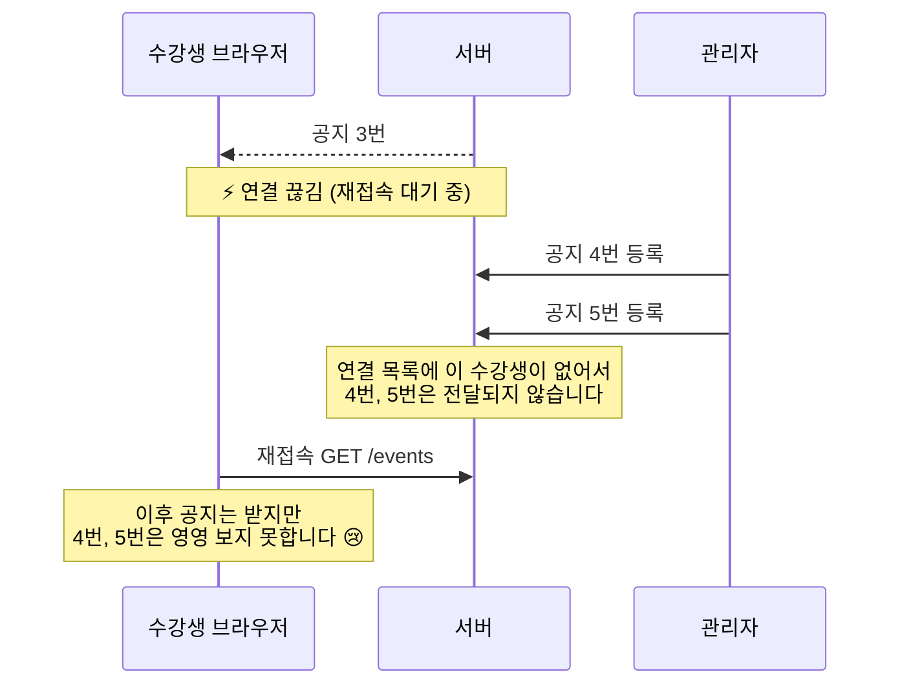
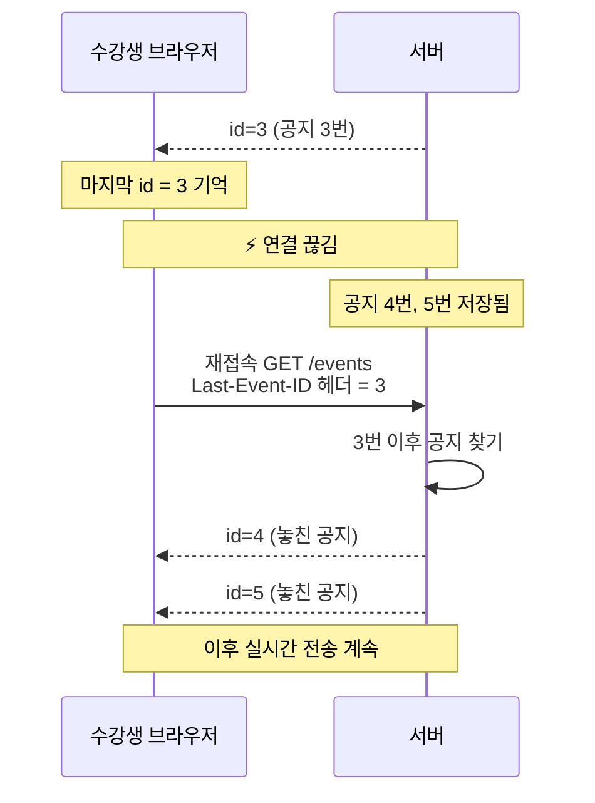

# SSE로 실시간 공지 보내기

> **실시간 통신 1차시** · 서버에서 클라이언트로 실시간 알림을 보내고, 연결의 시작부터 끝까지 관리하기
>
> 📘 개념 설명 → 📝 [실습 (30분)](./02-practice.md)

---

## 들어가며

### 이번 시간의 목표

이번 시간을 마치면 다음을 할 수 있습니다.

1. 요청-응답 방식과 폴링만으로는 <b>"서버가 먼저 알려야 하는 기능"</b>을 만들기 어려운 이유를 설명할 수 있습니다.
2. SSE가 **하나의 HTTP 연결을 열어 둔 채** 이벤트를 흘려보내는 원리와 `text/event-stream` MIME 타입을 설명할 수 있습니다.
3. Express에서 **연결된 클라이언트 목록**을 관리하면서 이벤트를 보내고, 연결이 끝나면 정리할 수 있습니다.
4. React에서 `EventSource`로 이벤트를 받고, 컴포넌트가 사라질 때 연결을 닫을 수 있습니다.
5. 연결이 끊겼을 때 브라우저가 **자동으로 재접속**하는 과정을 이해하고, `id`와 `Last-Event-ID`로 **놓친 이벤트를 이어받을** 수 있습니다.

> 💡 **MIME 타입이 무엇인가요?** 주고받는 데이터가 **어떤 형식인지** 알려 주는 이름입니다. 원래 이메일에 여러 종류의 파일을 담으려고 만든 규칙(Multipurpose Internet Mail Extensions)에서 나온 이름인데, 지금은 웹에서도 그대로 씁니다. `종류/세부 형식` 꼴로 쓰고, HTTP에서는 `Content-Type` 헤더에 담아 보냅니다. 브라우저는 이 값을 보고 응답을 어떻게 처리할지 정합니다. `text/html`이면 웹 페이지로 그리고, SSE에서는 `text/event-stream`이어야 `EventSource`가 응답을 이벤트로 읽습니다.
>
> **MIME 타입에는 `text/event-stream` 외에 또 어떤 타입들이 있나요?** 웹 개발에서 자주 만나는 타입은 다음과 같습니다.
>
> - `text/html`: 웹 페이지(HTML 문서)
> - `text/css`, `text/javascript`: 스타일시트, 자바스크립트 파일
> - `application/json`: JSON 데이터. Express의 `res.json()`이 보내는 응답이 이 타입입니다.
> - `image/png`, `image/jpeg`: 이미지
> - `multipart/form-data`: 파일을 함께 보내는 폼 데이터
> - `text/event-stream`: 오늘 배울 SSE의 이벤트 스트림
>
> 뒤에 `text/event-stream; charset=utf-8`처럼 문자 인코딩 같은 정보가 붙기도 합니다.

### 미리 알고 있어야 하는 것

- Express에서 라우트를 만들고 `req`, `res`를 다뤄 본 경험
- React의 `useState`, `useEffect` 훅을 사용해 본 경험
- `fetch`로 API를 호출하고, HTTP 요청·응답 헤더가 무엇인지 아는 정도

### 오늘의 사례: 부트캠프 실시간 공지

여러분이 지금 듣고 있는 부트캠프에도 공지가 자주 올라옵니다. 이번 시간에는 이런 기능을 만들어 보겠습니다.

> 운영 매니저가 <b>"오늘 오후 3시에 현직자 특강이 있어요."</b>라는 공지를 올리면,
> 지금 접속해 있는 **모든 수강생 화면에 새로고침 없이 바로** 공지가 떠야 합니다.



공지를 **저장하는 것**은 지금까지 배운 REST API로 충분합니다. 어려운 부분은 저장된 공지를 **수강생 화면까지 바로 전달하는 것**입니다. 오늘은 이 문제를 단계별로 풀어 보겠습니다.

| 장 | 내용 | 예제 코드에서 하는 일 |
|---|---|---|
| 1 | 요청-응답과 폴링의 한계 | 새로고침해야 보이는 공지 |
| 2 | SSE의 동작 원리 | 끝나지 않는 응답으로 이벤트 흘려보내기 |
| 3 | 서버의 연결 관리 | 연결 목록 관리, 모든 수강생에게 전송, 연결 정리 |
| 4 | React에서 받기 | 수강생 화면에 공지 띄우기 |
| 5 | 연결이 끊기면 | 자동 재접속, 놓친 공지 이어받기 |

---

## 1. 새로고침해야 보이는 공지

### 1.1 HTTP에서는 묻는 쪽만 말을 걸 수 있습니다

지금까지 만든 API는 모두 이런 모양이었습니다.



HTTP는 **클라이언트가 요청해야 서버가 응답하는** 구조입니다. 서버는 "새 공지가 올라왔어요!"라고 먼저 말을 걸 방법이 없습니다.

그래서 매니저가 공지를 올려도, 수강생은 **새로고침을 하기 전까지** 공지가 올라온 줄 모릅니다. 택배 조회 페이지를 직접 새로고침해야 배송 상태를 알 수 있는 것과 같습니다.

### 1.2 폴링: "새 공지 있어요?"라고 계속 물어보기

가장 먼저 떠오르는 방법은 **일정한 간격으로 계속 물어보는 것**입니다. 이것을 <b>폴링(polling)</b>이라고 합니다.

```tsx
// 3초마다 공지 목록을 다시 불러와요.
useEffect(() => {
  const timer = setInterval(async () => {
    const res = await fetch("http://localhost:4000/notices");
    setNotices(await res.json());
  }, 3000);

  return () => clearInterval(timer);
}, []);
```

동작은 합니다. 하지만 두 가지 문제가 있습니다.

- **전달이 늦습니다.** 3초마다 물어보기 때문에 공지가 올라온 뒤 최대 3초 늦게 보입니다.
- **낭비가 큽니다.** 수강생 100명이 3초마다 물어보면 1분에 **2,000번** 요청이 옵니다. 그런데 공지는 하루에 몇 개 올라오지 않습니다. 응답 대부분이 "새 공지 없음"입니다.

간격을 줄이면 전달 속도는 빨라지지만 낭비가 커지고, 간격을 늘리면 낭비는 줄지만 전달이 늦어집니다.

| 폴링 간격 | 최대 지연 | 수강생 100명일 때 분당 요청 수 |
|---|---|---|
| 1초 | 1초 | 6,000번 |
| 3초 | 3초 | 2,000번 |
| 10초 | 10초 | 600번 |

> 💡 **폴링이 나쁜 방법은 아닙니다.** 바뀌는 일이 드물고 조금 늦어도 괜찮은 정보라면 폴링이 가장 간단한 답일 수 있습니다. 실습 앱의 관리자 화면에 있는 "현재 연결 수"도 개발자만 보는 정보라서 일부러 2초 간격 폴링으로 만들었습니다. 기술은 상황에 맞게 고르는 것입니다.

### 1.3 필요한 것: 서버가 먼저 보낼 수 있는 통로

공지처럼 **"일이 생긴 순간 바로"** 알려야 하는 기능은 생각보다 많습니다.

- 알림: 새 공지, 내 글에 달린 댓글, 주문·배송 상태 변경
- 진행 상황: 파일 업로드·영상 변환·배포 진행률
- 실시간 값: 주식 시세, 경기 점수
- AI 답변: ChatGPT 같은 서비스에서 답변이 한 글자씩 나타나는 화면 (많은 LLM API가 오늘 배울 SSE 형식으로 응답을 흘려보냅니다)

이런 기능에는 **서버가 원할 때 클라이언트에게 데이터를 보낼 수 있는 통로**가 필요합니다. 대표적인 방법이 두 가지입니다.

- **SSE (Server-Sent Events)**: 서버 → 클라이언트 **한 방향**으로 이벤트를 보냅니다. ← 오늘 배울 것
- **WebSocket**: 서버 ↔ 클라이언트 **양방향**으로 메시지를 주고받습니다. ← 다음 시간에 배울 것

---

## 2. SSE는 어떻게 동작할까요?

### 2.1 핵심 아이디어: 끝나지 않는 응답

SSE의 아이디어는 아주 단순합니다.

> 클라이언트가 요청을 한 번 보내면, 서버는 응답을 **끝내지 않고 열어 둔 채**, 보낼 일이 생길 때마다 그 응답에 조금씩 **이어서 씁니다.**



중요한 점은 **SSE가 평범한 HTTP**라는 것입니다. 새로운 프로토콜이 아니라, 우리가 아는 GET 요청과 응답을 오래 열어 두는 것뿐입니다. 그래서 Express로 바로 만들 수 있습니다.

### 2.2 text/event-stream 형식

서버가 흘려보내는 내용은 정해진 텍스트 형식을 따라야 브라우저가 이벤트로 알아듣습니다. 이 형식의 이름이 <b>`text/event-stream`</b>입니다. 실습 앱의 서버가 실제로 보내는 내용을 그대로 옮기면 다음과 같습니다.

```text
retry: 3000

id: 1
event: notice
data: {"id":1,"message":"오늘 오후 3시에 현직자 특강이 있어요.","createdAt":"2026-11-13T02:53:14.120Z"}

id: 2
event: notice
data: {"id":2,"message":"점심시간이 12시 30분으로 바뀌었어요.","createdAt":"2026-11-13T02:53:15.311Z"}

```

규칙은 두 가지뿐입니다.

1. 한 줄에 하나씩 <b>`필드: 값`</b>으로 씁니다.
2. <b>빈 줄 하나가 "이벤트 하나 끝"</b>이라는 뜻입니다. 빈 줄을 빠뜨리면 브라우저는 이벤트가 아직 끝나지 않았다고 보고 전달하지 않습니다.

| 필드 | 의미 | 공지 앱에서 쓰는 값 |
|---|---|---|
| `data` | 이벤트 내용. **문자열만** 쓸 수 있습니다. | 공지 객체를 `JSON.stringify()` 한 문자열 |
| `event` | 이벤트 이름. 생략하면 `message`로 취급합니다. | `notice` |
| `id` | 이벤트 번호. 브라우저가 기억해 뒀다가 재접속할 때 서버에 알려 줍니다. (5장) | 공지 id |
| `retry` | 연결이 끊겼을 때 다시 접속하기까지 기다릴 시간(ms) (5장) | `3000` |
| `:` 로 시작하는 줄 | 주석. 브라우저가 무시합니다. | (다음 시간에 '하트비트'로 씁니다) |

> ⚠️ `data`에는 문자열만 쓸 수 있습니다. 객체를 그대로 쓰면 `[object Object]`가 전송됩니다. 보낼 때 `JSON.stringify()`, 받을 때 `JSON.parse()`를 씁니다.

### 2.3 직접 보기: 작은 SSE 서버

실습 저장소의 `starter/server/examples/hello-sse.ts`는 1초마다 현재 시각을 보내는 작은 SSE 서버입니다.

```ts
app.get("/time", (req, res) => {
  // ① "이 응답은 이벤트 스트림이에요"라고 알리고 헤더를 바로 보내요.
  res.set({
    "Content-Type": "text/event-stream",
    "Cache-Control": "no-cache",
    Connection: "keep-alive",
  });
  res.flushHeaders();

  // ② res.end()를 부르지 않고, 1초마다 이벤트를 하나씩 write() 해요.
  let count = 0;
  const timer = setInterval(() => {
    count++;
    res.write(`id: ${count}\n`);
    res.write(`data: ${new Date().toLocaleTimeString("ko-KR")}\n\n`);
  }, 1000);

  // ③ 클라이언트가 떠나면 타이머를 정리해요.
  res.on("close", () => {
    clearInterval(timer);
  });
});
```

지금까지는 `res.json()`이나 `res.send()`로 응답을 **한 번에 보내고 끝냈습니다.** SSE에서는 `res.write()`로 **조금씩 이어서 쓰고, 끝내지 않습니다.** SSE 서버가 하는 일은 이것이 전부입니다. ①헤더 보내기, ②끝내지 않고 계속 쓰기, ③떠나면 정리하기.

터미널 두 개를 열고 직접 확인해 봅시다.

```bash
# 터미널 1: 예제 서버 실행
cd starter/server
npx tsx examples/hello-sse.ts

# 터미널 2: 스트림 받아 보기 (-N: 받은 데이터를 모아 두지 않고 바로 출력)
curl -N http://localhost:4001/time
```

```text
id: 1
data: 오전 11:49:36

id: 2
data: 오전 11:49:37

id: 3
data: 오전 11:49:38
```

요청은 한 번 보냈는데 응답이 1초마다 계속 이어서 도착합니다. curl을 `Ctrl + C`로 끄면 서버 터미널에 다음과 같이 찍힙니다.

```text
클라이언트 연결 종료 → 타이머 정리 (보낸 이벤트 3개)
```

### 2.4 브라우저에서 받기: EventSource

브라우저에는 SSE를 받기 위한 API인 <b>`EventSource`</b>가 내장되어 있습니다. 예제 서버가 켜진 상태에서 브라우저로 `http://localhost:4001`에 접속하면, 아래와 같은 코드로 이벤트를 받아 화면에 보여 주는 페이지를 볼 수 있습니다.

```js
const es = new EventSource("/time"); // 연결 시작

es.onopen = () => console.log("연결됨");
es.onmessage = (event) => {
  console.log("받음:", event.data, "/ id:", event.lastEventId);
};
es.onerror = () => console.log("에러, readyState =", es.readyState);

// es.close();  // 연결을 닫고 싶을 때
```

| 이벤트 | 호출되는 때 |
|---|---|
| `onopen` | 연결이 열렸을 때 (서버가 헤더를 보냈을 때) |
| `onmessage` | **이름이 없는**(`event:` 줄이 없는) 이벤트가 왔을 때 |
| `addEventListener("이름", ...)` | `event: 이름` 으로 **이름 붙은** 이벤트가 왔을 때 |
| `onerror` | 연결에 문제가 생겼을 때 (끊김, 연결 실패 등) |

`es.readyState`로 지금 연결 상태를 알 수 있습니다.

| 값 | 상수 | 의미 |
|---|---|---|
| 0 | `EventSource.CONNECTING` | 연결하는 중 (재접속 중일 때도 이 값입니다) |
| 1 | `EventSource.OPEN` | 연결됨 |
| 2 | `EventSource.CLOSED` | 닫힘. 브라우저가 더 이상 재접속하지 않습니다. |

> ⚠️ 공지 앱처럼 서버가 `event: notice`라고 이름을 붙여서 보내면, 그 이벤트는 **`onmessage`로 오지 않습니다.** `es.addEventListener("notice", ...)`로 받아야 합니다. 처음 SSE를 쓸 때 가장 많이 하는 실수입니다.

<b>개발자 도구로 스트림 보기:</b> 이 페이지에서 개발자 도구(F12) → **Network** 탭 → `time` 요청을 클릭하면 **EventStream** 탭이 보입니다. 이벤트가 도착할 때마다 한 줄씩 늘어나는 것을 볼 수 있습니다. 실습에서도 이 화면으로 결과를 확인합니다.

### 2.5 그렇다면 WebSocket은 어떨까요?

다음 시간에 배울 WebSocket과 간단히 비교해 보겠습니다.

| | SSE | WebSocket |
|---|---|---|
| 방향 | 서버 → 클라이언트 (한 방향) | 서버 ↔ 클라이언트 (양방향) |
| 프로토콜 | 평범한 HTTP | HTTP로 시작해서 WebSocket 프로토콜로 전환 |
| 보낼 수 있는 데이터 | 텍스트 | 텍스트, 바이너리 |
| 끊겼을 때 재접속 | **브라우저가 자동으로** | 직접 구현해야 합니다 |
| 놓친 메시지 이어받기 | `id`와 `Last-Event-ID`로 하는 **표준 방식이 있습니다** | 직접 구현해야 합니다 |
| 브라우저 API | `EventSource` | `WebSocket` |

공지 앱에서 실시간으로 필요한 건 **서버 → 수강생** 방향뿐입니다. 매니저가 공지를 올리는 것은 지금처럼 `POST` 요청으로 충분합니다. 그래서 재접속까지 브라우저가 알아서 해 주는 **SSE가 더 단순한 선택**입니다.

반대로 채팅처럼 **양쪽이 수시로 주고받아야 하는** 기능이라면 WebSocket이 더 잘 맞습니다. WebSocket은 다음 시간에 다루겠습니다.

> 💡 SSE에도 알아 둘 제약이 있습니다.
> - 브라우저의 `EventSource`는 **GET 요청만** 보낼 수 있고, `Authorization` 같은 **헤더를 직접 넣을 수 없습니다.** 로그인한 사용자만 공지를 받게 하려면 쿠키를 쓰는 식으로 해결합니다.
> - HTTP/1.1에서는 브라우저가 **같은 서버에 동시에 열 수 있는 연결이 6개**로 제한됩니다. SSE 연결은 계속 열려 있으므로 같은 페이지를 탭 여러 개로 열면 이 자리를 금방 다 차지합니다. 그러면 새 탭은 연결되지 않고, 같은 서버로 보내는 다른 요청까지 기다리게 됩니다. 그래서 실습에서는 수강생 탭을 5개 이하로 엽니다. (실무에서는 HTTP/2를 쓰면 이 제한이 사실상 사라집니다)

---

## 3. Express로 SSE 서버 만들기

이제 공지 앱 서버를 만들어 보겠습니다. 서버는 세 파일로 나뉘어 있습니다.

```text
server/src/
├── index.ts          # 라우트 정의 (POST /notices, GET /events ...)
├── notice-store.ts   # 공지 저장소 (메모리 배열)
└── sse.ts            # SSE 연결 관리 ← 오늘의 핵심
```

### 3.1 SSE 엔드포인트 열기

```ts
// GET /events
export function handleEvents(req: Request, res: Response) {
  res.set({
    "Content-Type": "text/event-stream",
    "Cache-Control": "no-cache",
    Connection: "keep-alive",
  });
  res.flushHeaders();

  res.write(`retry: ${RETRY_MS}\n\n`); // 끊기면 3초 뒤에 다시 접속해 달라고 알려줘요.
  // ...
}
```

| 코드 | 하는 일 |
|---|---|
| `Content-Type: text/event-stream` | "이 응답은 이벤트 스트림입니다." 브라우저는 이 헤더를 보고 응답을 SSE로 해석합니다. **없으면 `EventSource`가 연결을 열지 못합니다.** |
| `Cache-Control: no-cache` | 브라우저나 중간 서버(프록시)가 이 응답을 저장해 두지 않게 합니다. |
| `Connection: keep-alive` | 연결을 계속 유지하겠다는 뜻입니다. (HTTP/1.1의 기본값이지만 의도를 드러내려고 적습니다) |
| `res.flushHeaders()` | 헤더를 **지금 바로** 보냅니다. 브라우저는 헤더를 받아야 "연결됐다(`onopen`)"고 판단합니다. |

> ⚠️ `res.json()`, `res.send()`, `res.end()`는 응답을 **끝냅니다.** SSE 연결을 유지하려면 이 메서드들을 부르지 않고 `res.write()`만 씁니다.

### 3.2 연결된 클라이언트 목록 관리하기

여기서 한 가지 문제가 생깁니다. 공지는 **매니저의 `POST /notices` 요청**으로 들어오는데, 공지를 보내야 할 곳은 **수강생들의 `GET /events` 응답**입니다. 서로 다른 요청입니다.

그래서 `POST` 핸들러에서 수강생들의 `res`에 접근할 수 있도록, **열려 있는 `res`를 한곳에 모아 둬야 합니다.**

```ts
// 연결된 클라이언트 목록 — key: 연결 번호, value: 그 연결의 응답 객체
const clients = new Map<number, Response>();
let nextClientId = 1;

export function handleEvents(req: Request, res: Response) {
  // ... (헤더 설정)

  const clientId = nextClientId++;
  clients.set(clientId, res); // 목록에 등록
  console.log(`[SSE] #${clientId} 연결됨 (현재 ${clients.size}개)`);
}
```



연결마다 번호를 붙여서 `Map`에 넣으면, 나중에 그 번호로 쉽게 지울 수 있고, 로그로 어떤 연결이 들어오고 나갔는지 추적하기도 좋습니다.

### 3.3 모든 수강생에게 보내기 (브로드캐스트)

목록이 있으니 보내는 것은 간단합니다. **목록을 돌면서 각 `res`에 이벤트를 쓰면** 됩니다. 이렇게 연결된 모두에게 같은 내용을 보내는 것을 <b>브로드캐스트(broadcast)</b>라고 합니다.

```ts
// 공지 등록 → 저장하고, 연결된 모두에게 보내요. (입력값 검사 코드는 생략)
app.post("/notices", (req, res) => {
  const notice = addNotice(req.body.message);
  broadcast(notice);
  res.status(201).json(notice);
});
```



`broadcast()` 안에서는 `clients`를 돌면서, 2.2에서 본 형식(`id`, `event`, `data`, 빈 줄)으로 공지를 씁니다. 이 부분은 실습에서 직접 작성합니다.

### 3.4 연결이 끝나면 정리하기

수강생이 탭을 닫거나, 새로고침하거나, 네트워크가 끊기면 그 연결은 끝납니다. 그런데 `clients` 목록에는 **여전히 그 `res`가 남아 있습니다.** 서버 측에서 직접 지워 줘야 합니다.

```ts
res.on("close", () => {
  clients.delete(clientId);
  console.log(`[SSE] #${clientId} 연결 종료 (현재 ${clients.size}개)`);
});
```

응답 스트림이 닫히면 `res`에서 `close` 이벤트가 발생합니다. 이때 목록에서 지우면 됩니다.

정리를 하지 않으면 이런 일이 생깁니다.

- 이미 끊긴 연결에 계속 `write()`를 합니다. 받을 사람이 없는 일을 계속하는 것입니다.
- 연결이 끊길 때마다 목록이 계속 커져서 **메모리가 샙니다.**
- "현재 연결 수" 같은 통계가 실제와 달라집니다.
- `hello-sse` 예제였다면, 아무도 듣지 않는데 `setInterval`이 영원히 돕니다.

> 💡 SSE 연결에는 <b>"끝날 때 할 일"</b>이 꼭 따라옵니다. 연결을 열 때 목록에 넣었다면 닫힐 때 빼고, 타이머를 만들었다면 닫힐 때 정리합니다.

### 3.5 한눈에 보는 연결 수명 주기 (서버)



실습을 하면서 서버 로그로 이 흐름을 직접 확인하게 됩니다.

```text
[SSE] #1 연결됨 (현재 1개)
[SSE] #2 연결됨 (현재 2개)
[SSE] 공지 #1 → 2개 연결에 전송
[SSE] #1 연결 종료 (현재 1개)
```

---

## 4. React에서 공지 받기

### 4.1 useEffect에서 연결하고, cleanup에서 닫기

수강생 화면에서는 `EventSource`로 서버에 연결합니다. 연결은 **컴포넌트가 화면에 나타날 때 열고, 사라질 때 닫아야** 합니다. React에서 이런 일은 `useEffect`가 담당합니다.

```tsx
"use client";

useEffect(() => {
  const eventSource = new EventSource(`${API_URL}/events`);

  eventSource.addEventListener("notice", (event) => {
    const notice: Notice = JSON.parse(event.data);
    setNotices((prev) => [notice, ...prev]);
  });

  return () => {
    eventSource.close(); // 컴포넌트가 사라질 때 연결을 닫아요.
  };
}, []);
```

- **`"use client"`**: `EventSource`는 브라우저에만 있는 API입니다. Next.js에서는 클라이언트 컴포넌트의 `useEffect` 안에서 만들어야 합니다. `useEffect`는 브라우저에서만 실행되기 때문입니다.
- **`addEventListener("notice", ...)`**: 서버가 `event: notice`로 보내므로 **`"notice"`** 이름으로 받습니다.
- **`return () => eventSource.close()`**: 이 정리(cleanup) 함수가 없으면, 페이지를 옮겨도 연결이 남아 계속 공지를 받습니다.

> ⚠️ **개발 모드에서 연결이 두 개?**
> React의 Strict Mode(Next.js 개발 모드에서는 기본으로 켜져 있습니다)는 실수를 찾을 수 있도록 <b>effect를 일부러 "실행 → 정리 → 다시 실행"</b>합니다. cleanup을 빠뜨리면 첫 번째 연결이 닫히지 않아서 **한 탭에 연결이 2개**가 됩니다. 그러면 같은 공지가 화면에 **두 번** 나타납니다. cleanup만 잘 써 두면 문제없습니다.

### 4.2 연결 상태 보여 주기

수강생 입장에서는 지금 공지를 받을 수 있는 상태인지를 화면 상에서 알 수 있으면 좋습니다. `onopen`, `onerror`와 `readyState`로 연결 상태를 화면에 보여 줄 수 있습니다.

```tsx
eventSource.onopen = () => setStatus("open"); // 연결됨
eventSource.onerror = () => {
  setStatus(
    eventSource.readyState === EventSource.CLOSED ? "closed" : "reconnecting"
  );
};
```

| 상황 | 호출되는 것 | `readyState` | 화면 표시 |
|---|---|---|---|
| 처음 연결 중 | (없음) | 0 `CONNECTING` | 연결 중 |
| 연결 성공 | `onopen` | 1 `OPEN` | 🟢 연결됨 |
| 연결 끊김, 재접속 시도 중 | `onerror` | 0 `CONNECTING` | 🟠 재연결 중 |
| 완전히 닫힘 | `onerror` | 2 `CLOSED` | 🔴 연결 끊김 |

`onerror`가 호출됐다고 해서 <b>연결이 끝난 것은 아닙니다.</b> 이 부분은 5장에서 자세히 살펴보겠습니다.



---

## 5. 연결이 끊기면 어떻게 될까요?

실제 서비스에서는 연결이 생각보다 자주 끊깁니다.

- 수강생의 Wi-Fi가 잠깐 끊기거나, 노트북을 덮었다 열었을 때
- 서버를 새 버전으로 배포하느라 재시작했을 때
- 중간 서버(프록시, 로드밸런서)가 오래 열린 연결을 끊었을 때

### 5.1 브라우저가 알아서 다시 연결합니다

`EventSource`의 가장 큰 장점은 **재접속을 브라우저가 알아서 해 준다**는 것입니다.



1. 연결이 끊기면 `onerror`가 호출되고, `readyState`가 <b>`CONNECTING`</b>으로 바뀝니다.
2. 브라우저는 **`retry` 시간**(공지 앱은 3초)만큼 기다렸다가 같은 주소로 다시 요청합니다.
3. 성공하면 `onopen`이 다시 호출됩니다. 실패하면 또 기다렸다가 다시 시도합니다.

`retry` 값은 서버가 스트림에 `retry: 3000`처럼 써서 정합니다. 서버가 보내지 않으면 브라우저 기본값(보통 몇 초)을 씁니다.

> ⚠️ `onerror`가 호출됐다고 `eventSource.close()`를 부르면 안 됩니다! 브라우저가 재접속하려는 것을 **스스로 막는 셈**입니다.

브라우저가 재접속을 포기하는(`CLOSED`가 되는) 경우는 다음과 같습니다.

- 코드에서 `eventSource.close()`를 불렀을 때
- 서버가 **200이 아닌 상태 코드**(예: 204 No Content, 401)로 응답하거나, `Content-Type`이 `text/event-stream`이 아닌 응답을 보냈을 때

그래서 서버가 "이제 그만 연결하세요"라고 하고 싶으면 **204 No Content**로 응답하면 됩니다.

### 5.2 끊긴 사이에 올라온 공지는 어떻게 될까요?

재접속이 된다고 끝이 아닙니다. **끊겨 있던 동안 올라온 공지**가 어떻게 되는지 따라가 보겠습니다.



서버는 공지가 올라온 순간 **그때 연결된 사람에게만** 보냅니다. 끊겨 있던 수강생은 그 공지를 놓칩니다. "오늘 오후 3시 특강" 공지를 놓쳤다면 곤란할 것입니다.

### 5.3 id와 Last-Event-ID로 이어받기

SSE에는 이 문제를 위한 **표준 방법**이 있습니다.

1. 서버는 이벤트마다 <b>`id`</b>를 붙여서 보냅니다.
2. 브라우저는 <b>마지막으로 받은 `id`</b>를 기억해 둡니다. (`event.lastEventId`로 확인할 수 있습니다)
3. 자동으로 재접속할 때, 브라우저가 그 값을 **`Last-Event-ID` 요청 헤더**에 담아서 보냅니다.
4. 서버는 헤더를 보고 <b>"3번까지 받았구나"</b>를 알 수 있습니다. 그래서 **4번부터 먼저 보내 주고**, 실시간 전송을 이어갑니다.



여기서 **서버가 해야 할 일**이 생깁니다.

- 놓친 공지를 다시 보내려면 서버가 **지난 공지를 보관하고 있어야** 합니다. 공지 앱은 `notice-store.ts`의 배열에 저장하고 있고, `getNoticesAfter(id)`로 특정 id 이후의 공지를 꺼낼 수 있습니다.
- 이벤트의 `id`로 **공지의 id를 그대로** 쓰면, 헤더 값으로 바로 "이후 공지"를 찾을 수 있습니다.

```ts
const lastEventId = req.get("Last-Event-ID"); // 재접속이면 "3" 같은 문자열, 첫 연결이면 undefined
```

이 값으로 놓친 공지를 보내는 코드는 실습에서 직접 작성합니다.

> ⚠️ **알아 둘 점**
> - **처음 연결할 때는 `Last-Event-ID` 헤더가 없습니다.** 받은 이벤트가 없기 때문입니다.
> - 헤더 값은 **문자열**입니다. 숫자로 바꿔서 비교합니다.
> - 이 헤더는 브라우저가 **자동 재접속할 때만** 붙입니다. 새로고침하거나 코드에서 `new EventSource()`로 새로 연결하면 붙지 않습니다. 새로고침 뒤에도 이어받고 싶다면, 마지막 id를 직접 저장해 뒀다가 쿼리스트링 등으로 보내야 합니다. (실습 도전 과제)

### 5.4 이 방식의 한계, 그리고 다음 시간

오늘 만든 구조는 **서버 한 대**에서 잘 동작합니다. 하지만 실제 서비스로 가면 이런 고민이 생깁니다.

| 한계 | 원인 | 실무에서는 |
|---|---|---|
| 서버를 재시작하면 놓친 공지를 찾지 못합니다 | 공지와 번호가 **메모리**에 있어서 재시작하면 사라집니다. 번호도 1번부터 다시 시작합니다. | 공지를 DB에 저장합니다. |
| 이력이 끝없이 쌓입니다 | 놓친 공지를 보내려고 모든 공지를 보관합니다. | 최근 N개, 최근 N분처럼 보관 범위를 정합니다. |
| 서버가 여러 대면 일부 수강생이 공지를 받지 못합니다 | `clients` 목록은 **서버 한 대의 메모리**에만 있습니다. A 서버로 들어온 공지는 B 서버에 연결된 수강생에게 전달되지 않습니다. | 서버들이 함께 쓰는 메시지 통로(예: **Redis Pub/Sub**)로 이벤트를 나눕니다. |
| **서버**가 이미 끊긴 연결을 모를 수 있습니다 | 수강생 노트북의 배터리가 꺼지거나 지하철에서 네트워크가 갑자기 사라지면, 브라우저는 "연결을 끝낸다"는 신호를 서버에 보내지 못합니다. 서버는 이 연결이 살아 있다고 보고 `clients`에 그대로 둡니다. 이 연결에 `res.write()`를 해도 바로 에러가 나지 않고, 운영체제가 전송 실패를 확정하기까지 수 분이 걸리기도 합니다. 공지가 드물면 쓸 일 자체가 없어서 더 오래 남습니다. | 서버가 15~30초마다 **하트비트**(예: `: ping` 주석 한 줄)를 보냅니다. 주기적으로 보내야 전송 실패가 드러나고, 그래야 `close` 이벤트가 발생해 목록에서 정리됩니다. |
| **브라우저**도 끊긴 연결을 모를 수 있습니다 | 공유기, 회사 방화벽, 통신사 장비처럼 중간에 있는 장비는 한동안 데이터가 오가지 않는 연결을 아무 신호 없이 정리하기도 합니다. 그러면 브라우저 쪽 연결은 계속 `OPEN`으로 남고 `onerror`도 호출되지 않아서, 자동 재접속이 시작되지 않습니다. 수강생 화면은 🟢 연결됨인데 새 공지는 오지 않는 상태가 됩니다. | 하트비트로 데이터가 계속 오가면 중간 장비가 연결을 쉬고 있다고 보지 않아 정리하지 않습니다. 더 확실하게 하려면 하트비트를 이름 붙은 이벤트(예: `event: ping`)로 보내고, 브라우저가 일정 시간(예: 45초) 동안 아무것도 받지 못하면 연결을 닫고 새로 연결합니다. 주석 줄은 `EventSource`가 무시해서 브라우저 코드로는 확인할 수 없고, 새로 연결할 때는 `Last-Event-ID`가 자동으로 붙지 않으니 마지막 id를 직접 넘겨야 합니다. |

이 고민들은 앞으로의 수업에서 하나씩 풀어 가겠습니다. WebSocket과 Socket.io로 양방향 통신을 하고, 하트비트로 연결 상태를 확인하고, Redis Pub/Sub으로 여러 서버에 이벤트를 전달합니다.

---

## 정리

| 질문 | 핵심 |
|---|---|
| SSE는 왜 필요합니까? | HTTP 프로토콜은 클라이언트가 먼저 요청을 해야 서버가 응답합니다. 폴링 방식은 전달이 늦거나 낭비가 큽니다. |
| SSE는 어떻게 동작합니까? | GET 요청 하나에 대한 응답을 **끝내지 않고**, `text/event-stream` 형식으로 이벤트를 계속 이어서 씁니다. |
| 서버는 무엇을 관리합니까? | 열려 있는 `res`를 **목록에 등록**하고, 이벤트가 생기면 **목록을 돌며 전송**하고, `close` 때 **목록에서 삭제**합니다. |
| 클라이언트는 무엇을 합니까? | `EventSource`로 연결하고, 이름이 붙은 이벤트는 `addEventListener`로 받고, cleanup에서 `close()`합니다. |
| 연결이 끊기면 어떻게 됩니까? | 브라우저가 `retry` 뒤에 **자동 재접속**합니다. `id`를 붙여 두면 <b>`Last-Event-ID`</b>로 놓친 이벤트를 이어받을 수 있습니다. |

### 스스로 확인해 보기

<details>
<summary>1. 수강생 100명이 5초 간격으로 폴링하면 1분에 요청이 몇 번 옵니까? SSE로 바꾸면 어떻게 달라집니까?</summary>

100명 × (60초 ÷ 5초) = 1분에 **1,200번**입니다. SSE로 바꾸면 수강생마다 연결을 **한 번만** 열어 두고, 공지가 있을 때만 데이터가 오갑니다.
</details>

<details>
<summary>2. 서버가 <code>event: notice</code>로 보냈는데 <code>onmessage</code>에서 아무것도 받지 못합니다. 왜일까요?</summary>

`onmessage`는 이름이 없는(`message`) 이벤트만 받습니다. 이름이 붙은 이벤트는 `addEventListener("notice", ...)`로 받아야 합니다.
</details>

<details>
<summary>3. <code>res.on("close")</code>에서 목록 삭제를 빠뜨리면 어떤 일이 생깁니까?</summary>

끊긴 연결이 목록에 계속 남습니다. 받을 사람이 없는 연결에 계속 `write()`하고, 메모리가 새고, 연결 수 통계가 실제와 달라집니다.
</details>

<details>
<summary>4. <code>onerror</code>가 호출됐을 때 <code>readyState</code>가 0입니다. 연결이 끝난 것일까요?</summary>

아닙니다. 0(`CONNECTING`)은 브라우저가 **재접속을 시도하는 중**이라는 뜻입니다. 완전히 닫혔다면 2(`CLOSED`)입니다.
</details>

<details>
<summary>5. 서버가 이벤트에 <code>id</code>를 붙이지 않으면, 재접속할 때 무엇이 달라집니까?</summary>

브라우저가 기억할 id가 없으니 `Last-Event-ID` 헤더를 보내지 않습니다. 서버는 이 클라이언트가 어디까지 받았는지 알 수 없어서 놓친 이벤트를 다시 보낼 수 없습니다.
</details>

---

👉 이제 직접 만들어 볼 차례입니다. [실습: 실시간 공지 알림 완성하기](./02-practice.md)
