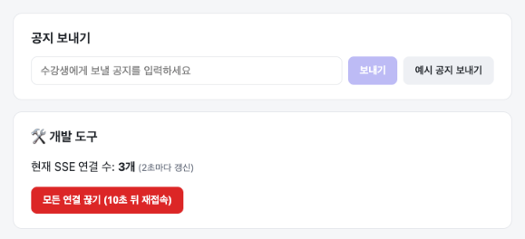
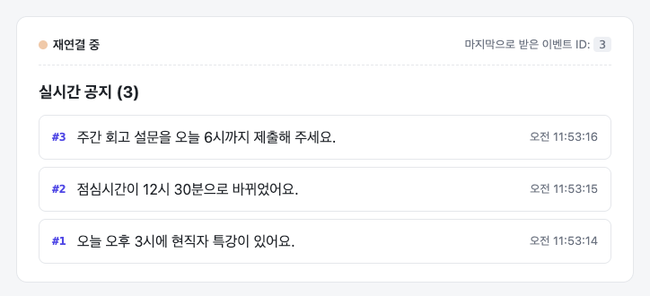
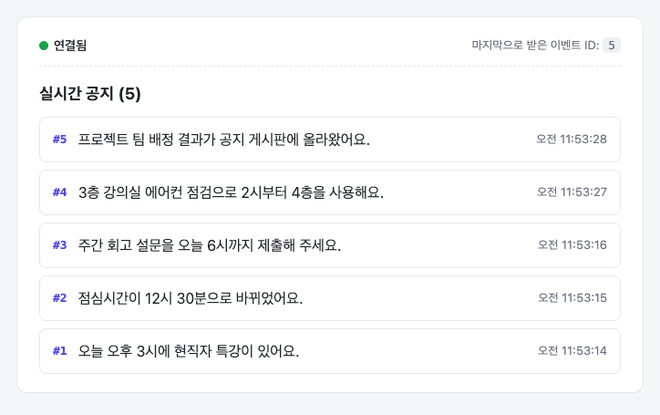

# 실습: 실시간 공지 알림 완성하기

> ⏱ **30분** (환경 준비가 끝난 상태 기준) · 📘 [개념 설명](./01-concept.md)에서 배운 내용을 직접 만들고 눈으로 확인해요.

공지를 쓰는 관리자 화면과 공지 목록을 보여 주는 수강생 화면은 이미 만들어져 있어요. 아직 비어 있는 건 **실시간 연결** 부분이에요. 서버에서는 SSE 연결을 관리하고, 클라이언트에서는 이벤트를 받는 코드를 채워서 앱을 완성해 볼게요.

---

## 1. 학습 목표

실습을 마치면 다음을 할 수 있어요.

| # | 학습 목표 | 관련 TODO |
|---|---|---|
| 목표 1 | Express에서 SSE 연결을 열고, 연결 목록에 **등록**하고, 연결이 닫히면 **정리**할 수 있어요. | TODO 1 |
| 목표 2 | `id`, `event`, `data`와 빈 줄로 이벤트를 만들어 **연결된 모든 클라이언트에게** 보낼 수 있어요. | TODO 2 |
| 목표 3 | React에서 `EventSource`로 이름 붙은 이벤트를 받고, 연결 상태를 표시하고, cleanup으로 연결을 닫을 수 있어요. | TODO 3 |
| 목표 4 | `Last-Event-ID`를 이용해 연결이 끊긴 사이 **놓친 공지를 다시 보낼** 수 있어요. | TODO 4 |
| 목표 5 | 개발자 도구, 서버 로그, curl로 **이벤트 스트림, 연결 정리, 재접속 과정을 직접 확인**하고 설명할 수 있어요. | 완료 조건 |

---

## 2. 실습 환경과 시작 코드

### 준비된 환경

- Node.js 20 이상 (작성 기준 v24), Chrome 브라우저
- 실습 저장소의 `starter/server`, `starter/client` 폴더에서 각각 `npm install`을 마친 상태

### 실행 방법

터미널을 3개 열어 주세요.

```bash
# 터미널 1: 서버 (http://localhost:4000)
cd starter/server
npm run dev

# 터미널 2: 클라이언트 (http://localhost:3000)
cd starter/client
npm run dev

# 터미널 3: 중간 확인용 (curl, npm run check)
cd starter/server
```

> 💡 서버는 `tsx watch`로 실행돼서, 코드를 저장하면 **자동으로 재시작**돼요. 공지는 메모리에 저장되니까 재시작하면 지금까지 보낸 공지가 사라지고 번호도 1번부터 다시 시작해요. 정상이에요.

### 시작 코드 살펴보기

```text
starter/
├── server/
│   ├── src/
│   │   ├── index.ts          # 라우트 정의 (제공)
│   │   ├── notice-store.ts   # 공지 저장소: addNotice, getNoticesAfter (제공)
│   │   └── sse.ts            # ✏️ TODO 1, 2, 4 — SSE 연결 관리
│   ├── scripts/check.ts      # 자동 확인 스크립트 (제공): npm run check
│   └── examples/hello-sse.ts # 개념 설명 2장 예제
└── client/
    ├── app/
    │   ├── page.tsx          # 수강생 화면 /  (제공)
    │   └── admin/page.tsx    # 관리자 화면 /admin (제공)
    ├── components/NoticeFeed.tsx  # 공지 목록과 연결 상태 표시 (제공)
    └── hooks/useNoticeStream.ts   # ✏️ TODO 3 — SSE 연결해서 공지 받기
```

**서버 API**

| 메서드와 경로 | 하는 일 | 상태 |
|---|---|---|
| `GET /events` | SSE 연결. 공지를 실시간으로 받아요. | ✏️ 직접 구현 (`sse.ts`의 `handleEvents`) |
| `POST /notices` | 공지를 등록하고 `broadcast()`를 호출해요. | 제공 (`broadcast`는 ✏️ 직접 구현) |
| `GET /notices` | 공지 목록 조회 | 제공 |
| `GET /dev/stats` | 현재 SSE 연결 수 확인 (개발용) | 제공 |
| `POST /dev/drop-connections` | 모든 SSE 연결을 끊고 10초 뒤 재접속하게 해요 (개발용) | 제공 |

**화면**

| 주소 | 화면 | 하는 일 |
|---|---|---|
| http://localhost:3000 | 수강생 화면 | 연결 상태, 마지막으로 받은 이벤트 ID, 실시간 공지 목록 |
| http://localhost:3000/admin | 관리자 화면 | 공지 보내기, **현재 SSE 연결 수** 보기, **모든 연결 끊기** (개발 도구) |



---

## 3. 수행 내용

TODO는 **번호 순서대로** 해 주세요. TODO마다 **중간 확인** 방법이 있어요. 확인을 통과한 뒤에 다음으로 넘어가요.

| TODO | 파일 | 할 일 | 권장 시간 |
|---|---|---|---|
| 1 | `server/src/sse.ts` → `handleEvents` | SSE 연결 열기, 목록에 등록, 닫히면 정리 | 8분 |
| 2 | `server/src/sse.ts` → `sendNotice`, `broadcast` | 이벤트 형식으로 쓰기, 모두에게 보내기 | 5분 |
| 3 | `client/hooks/useNoticeStream.ts` | `EventSource`로 연결하고 공지 받기 | 7분 |
| 4 | `server/src/sse.ts` → `handleEvents` | `Last-Event-ID`로 놓친 공지 다시 보내기 | 5분 |
| ✅ | — | 완료 조건 확인 | 5분 |

### TODO 1. SSE 연결 열고, 등록하고, 정리하기 (8분)

`server/src/sse.ts`의 `handleEvents` 함수를 완성해요.

- **1-1.** 응답 헤더 3개(`Content-Type: text/event-stream`, `Cache-Control: no-cache`, `Connection: keep-alive`)를 설정하고, 헤더를 바로 보내요.
- **1-2.** 연결 번호(`clientId`)를 발급해서 `clients`에 등록하고, 현재 연결 수를 로그로 남겨요.
- **1-3.** 연결이 닫히면 `clients`에서 지우고, 로그를 남겨요.

> `retry` 줄을 쓰는 코드는 미리 들어 있어요. 지우지 마세요.

**🔍 중간 확인:** 터미널 3에서 curl로 연결해 보세요. `-i`는 응답 헤더도 함께 보여 주는 옵션이에요.

```bash
curl -i -N http://localhost:4000/events
```

- 응답 헤더에 `Content-Type: text/event-stream`이 보여야 해요.
- 그 아래에 `retry: 3000`이 나오고, curl이 **끝나지 않고 계속 기다리면** 성공이에요.
- 서버 터미널에 `#1 연결됨 (현재 1개)` 같은 로그가 찍혀야 해요.
- curl을 `Ctrl + C`로 끄면 서버 터미널에 `연결 종료 (현재 0개)`가 찍혀야 해요.

### TODO 2. 공지를 이벤트 형식으로 모두에게 보내기 (5분)

같은 파일에서 두 함수를 완성해요.

- **2-1. `sendNotice(res, notice)`**: 공지 하나를 아래 형식으로 써요. 마지막 빈 줄을 잊지 마세요.

  ```text
  id: 3
  event: notice
  data: {"id":3,"message":"...","createdAt":"..."}

  ```

- **2-2. `broadcast(notice)`**: `clients`에 있는 모든 연결에 `sendNotice()`를 호출해요.

**🔍 중간 확인:** `curl -N http://localhost:4000/events`를 켜 둔 상태에서, 관리자 화면(http://localhost:3000/admin)의 **[예시 공지 보내기]** 를 누르세요.

- curl 화면에 `id`, `event`, `data` 세 줄과 빈 줄이 나타나면 성공이에요.
- 터미널을 하나 더 열고 curl을 2개 켜 두면, **두 곳 모두에** 같은 공지가 나타나야 해요.

### TODO 3. React에서 공지 받기 (7분)

`client/hooks/useNoticeStream.ts`의 `useEffect` 안을 완성해요.

- **3-1.** `${API_URL}/events`로 `EventSource` 연결을 열어요.
- **3-2.** 연결 상태가 바뀌면 `setStatus()`로 알려요.
  - 연결되면 `"open"`
  - 에러가 나면, `readyState`가 `EventSource.CLOSED`일 때 `"closed"`, 아니면 `"reconnecting"`
- **3-3.** `notice` 이벤트를 받아서
  - `event.data`(JSON 문자열)를 `Notice` 객체로 바꿔 **목록 맨 앞에** 추가하고 (`setNotices`)
  - `event.lastEventId`를 `setLastEventId()`로 저장해요.
- **3-4.** 컴포넌트가 사라질 때 연결을 닫는 cleanup 함수를 반환해요.

**🔍 중간 확인:** 수강생 화면(http://localhost:3000)을 열어 보세요.

- 상태가 **🟢 연결됨**으로 바뀌어야 해요.
- 관리자 화면에서 공지를 보내면 수강생 화면 목록에 공지가 나타나고, **마지막으로 받은 이벤트 ID**가 바뀌어야 해요.
- 관리자 화면의 **현재 SSE 연결 수**가 열어 둔 수강생 탭 수와 같아야 해요. (curl은 꺼 두세요)

### TODO 4. 놓친 공지 이어받기 (5분)

다시 `server/src/sse.ts`의 `handleEvents`로 돌아가서, TODO 4 자리를 완성해요.

- 요청 헤더 `Last-Event-ID`를 읽어요. 첫 연결이라면 이 헤더가 없어요.
- 헤더가 있다면, 그 id보다 큰 공지를 `getNoticesAfter()`로 찾아서 `sendNotice()`로 **먼저** 보내 줘요.
- 몇 개를 다시 보냈는지 로그로 남기면 확인하기 좋아요.

**🔍 중간 확인:** 관리자 화면에서 공지를 2~3개 보낸 뒤 curl로 확인해 보세요. 헤더를 직접 넣어서 재접속을 흉내 내는 거예요.

```bash
curl -N -H "Last-Event-ID: 1" http://localhost:4000/events
```

- 연결하자마자 **2번 이후의 공지**가 바로 나타나면 성공이에요.

---

## 4. 완료 조건

아래 6가지를 모두 확인하면 실습 완료예요. 각 항목을 확인하면서 **왜 그렇게 동작하는지** 한 문장으로 설명해 보세요.

### ✅ 조건 1. 자동 확인 스크립트 통과 (목표 1, 2, 4)

서버를 켜 둔 상태에서 터미널 3에서 실행해요.

```bash
npm run check
```

```text
✅ [TODO 1] GET /events가 text/event-stream으로 바로 응답해요
✅ [TODO 1] 연결하면 연결 목록에 등록되고, 끊으면 목록에서 지워져요
✅ [TODO 2] 공지를 등록하면 연결된 모든 클라이언트가 같은 notice 이벤트를 받아요
✅ [TODO 4] Last-Event-ID를 보내면 그 뒤의 공지를 먼저 다시 보내줘요

결과: 4개 중 4개 통과 🎉
```

> 확인 과정에서 `[자동 확인]` 공지가 몇 개 등록돼요. 브라우저에 보여도 괜찮아요.

### ✅ 조건 2. 여러 탭에서 같은 공지를 동시에 받기 (목표 2, 3)

- 수강생 화면을 **탭 3개**로 열고, 관리자 화면 탭을 하나 더 열어요. (수강생 탭은 5개 이하로 열어 주세요. 이유는 [개념 설명 2.5](./01-concept.md#25-그럼-websocket은요)에 있어요)
- 관리자 화면에서 공지를 보내면 **3개 탭 모두에 같은 공지가 바로** 나타나요.
- 관리자 화면의 현재 SSE 연결 수가 **3개**예요.

### ✅ 조건 3. 개발자 도구에서 이벤트 스트림 보기 (목표 5)

- 수강생 탭에서 개발자 도구(F12) → **Network** 탭을 열고 새로고침해요.
- 목록에서 **`events`** 요청을 클릭하고 **EventStream** 탭을 열어요.
- 공지를 보내면 한 줄씩 추가되고, **Id**, **Type**(`notice`), **Data**(공지 JSON)가 보여요.

### ✅ 조건 4. 연결이 닫히면 서버가 정리하기 (목표 1, 5)

- 수강생 탭 하나를 **닫아요**.
- 서버 터미널에 `연결 종료` 로그가 찍히고, 관리자 화면의 현재 SSE 연결 수가 **1 줄어들어요.**

### ✅ 조건 5. 서버를 껐다 켜도 자동으로 다시 연결되기 (목표 3, 5)

- 서버 터미널에서 `Ctrl + C`로 서버를 꺼요. 수강생 화면이 **🟠 재연결 중**으로 바뀌어요.
- `npm run dev`로 서버를 다시 켜요. **새로고침하지 않아도** 수강생 화면이 **🟢 연결됨**으로 돌아와요.

### ✅ 조건 6. 끊긴 사이에 놓친 공지 이어받기 (목표 4, 5)

1. 수강생 탭에서 개발자 도구 Network 탭을 열어 둬요.
2. 관리자 화면에서 **[모든 연결 끊기 (10초 뒤 재접속)]** 를 눌러요. 수강생 화면이 **🟠 재연결 중**이 돼요.
3. **10초 안에** 관리자 화면에서 공지를 **2개** 보내요.
4. 재접속되면 수강생 화면에 그 **2개가 모두** 나타나고, **마지막으로 받은 이벤트 ID**가 바뀌어요.
5. Network 탭에 **새 `events` 요청**이 생겨요. 그 요청의 **Headers → Request Headers**에 **`Last-Event-ID`** 가 보여요.
6. 서버 터미널에 `재접속 (Last-Event-ID: n) → 놓친 공지 2개 전송` 같은 로그가 찍혀요.

| 연결이 끊긴 동안 | 재접속 후 |
|---|---|
|  |  |

---

## 5. 막혔을 때 힌트

먼저 스스로 생각해 보고, 그래도 막히면 하나씩 열어 보세요.

<details>
<summary>TODO 1 힌트</summary>

- 헤더 여러 개는 `res.set({ "이름": "값", ... })`으로 한 번에 설정할 수 있어요.
- 헤더를 바로 보내는 메서드는 `res.flushHeaders()`예요.
- 응답을 **끝내면 안 돼요.** `res.json()`, `res.send()`, `res.end()`를 부르지 않았는지 확인해 보세요.
- 연결이 닫힐 때는 `res`에서 `"close"` 이벤트가 발생해요. `res.on("close", () => { ... })`
- curl에 아무것도 안 나오고 서버 로그도 없다면, 서버 터미널에 에러가 없는지 먼저 확인해 보세요.
</details>

<details>
<summary>TODO 2 힌트</summary>

- 줄바꿈은 `\n`, 이벤트 끝을 뜻하는 빈 줄은 `\n\n`이에요. 마지막 `data` 줄 끝에 `\n\n`을 붙이면 돼요.
- `data`에는 문자열만 쓸 수 있어요. `JSON.stringify(notice)`
- `Map`의 값만 돌고 싶다면 `for (const res of clients.values()) { ... }`
</details>

<details>
<summary>TODO 3 힌트</summary>

- 서버가 `event: notice`로 이름을 붙여서 보내요. `onmessage`가 아니라 `addEventListener("notice", (event) => { ... })`로 받아요.
- 이전 목록에 새 공지를 앞에 붙일 때는 `setNotices((prev) => [notice, ...prev])`
- `useEffect`에서 함수를 `return`하면 컴포넌트가 사라질 때 실행돼요.
- **같은 공지가 두 번씩 나온다면?** cleanup을 빠뜨렸을 가능성이 커요. 개발 모드에서는 effect가 두 번 실행되거든요.
- 화면이 계속 **연결 중**이라면 서버의 `Content-Type` 헤더를 확인해 보세요. `curl -i http://localhost:4000/events`로 응답 헤더를 볼 수 있어요.
</details>

<details>
<summary>TODO 4 힌트</summary>

- 요청 헤더는 `req.get("Last-Event-ID")`로 읽어요. 없으면 `undefined`예요.
- 헤더 값은 문자열이에요. `Number()`로 바꾼 뒤, 정수인지 `Number.isInteger()`로 확인해 보세요.
- 놓친 공지는 `getNoticesAfter(id)`가 찾아 줘요. 찾은 공지를 하나씩 `sendNotice(res, notice)`로 보내요.
- TODO 1-2(등록)보다 **위에** 작성하면 "놓친 공지 → 새 공지" 순서가 자연스러워요.
</details>

---

## 6. 다 끝났다면: 도전 과제

시간이 남으면 하나 골라서 도전해 보세요.

1. **하트비트 맛보기**: 서버가 15초마다 모든 연결에 주석 한 줄(`: ping\n\n`)을 보내게 해 보세요. curl에는 보이지만 브라우저의 EventStream 탭에는 안 보여요. 왜 그럴까요? 연결이 닫힐 때 타이머 정리도 잊지 마세요.
2. **이력 개수 제한**: 놓친 공지를 다시 보낼 때 **최근 50개까지만** 보내도록 바꿔 보세요. 더 오래 끊겨 있던 클라이언트에게는 어떤 안내를 해 주면 좋을까요?
3. **새로고침해도 이어받기**: 새로고침하면 `Last-Event-ID`가 보내지지 않아요. 마지막 id를 `localStorage`에 저장했다가 `/events?lastEventId=3`처럼 보내고, 서버는 헤더와 쿼리스트링을 모두 확인하게 바꿔 보세요.
4. **연결 수도 실시간으로**: 관리자 화면의 "현재 SSE 연결 수"는 지금 2초 간격 폴링이에요. 연결이 늘거나 줄 때 `event: stats` 이벤트로 보내도록 바꿔 보세요.
