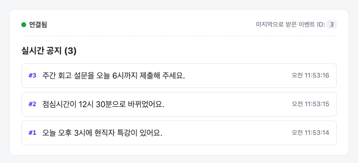
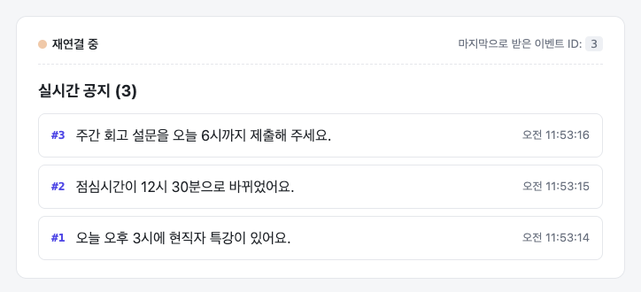
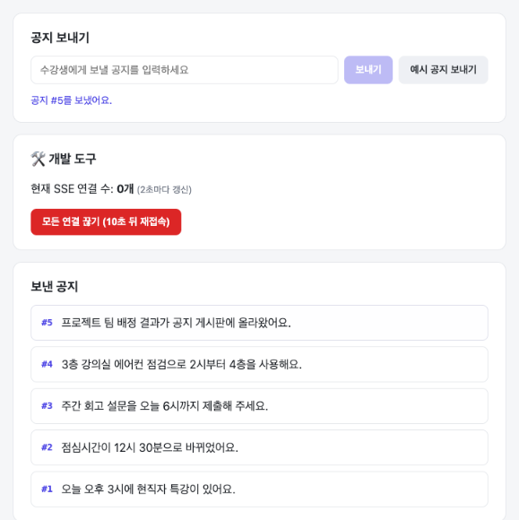
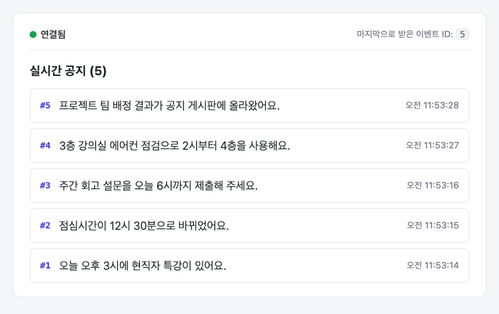

# [강사용] 실습 답안 및 해설

> 🔒 **강사용 문서입니다.** 수강생에게는 [실습 문제](./02-practice.md)만 제공합니다.
> 예시 풀이 코드 전체는 저장소의 `solution/` 폴더에 있습니다. 시작 코드(`starter/`)와 비교하면 TODO 부분만 다릅니다.

---

## 1. 출제 의도

### 이 실습으로 익히려는 것

이번 차시의 핵심은 <b>"연결을 열고 끝내는 것까지가 SSE"</b>라는 감각입니다. 이벤트를 보내는 코드는 몇 줄이면 되지만, 실무에서 문제가 되는 것은 대부분 **연결의 수명 주기**입니다. 끊긴 연결을 정리하지 않거나, 재접속 중에 이벤트를 놓치는 식입니다. 그래서 실습을 강의 3~5장의 흐름(연결 관리 → 전송 → 수신 → 끊김)과 똑같은 순서로 구성하고, 각 단계마다 수강생이 결과를 **눈으로 확인**하게 했습니다.

| 학습 목표 | TODO | 확인하는 완료 조건 | 강의 |
|---|---|---|---|
| 목표 1. 연결 열기, 등록, 정리 | TODO 1 | 조건 1, 조건 4 (탭 닫으면 연결 수 감소) | 3.1, 3.2, 3.4 |
| 목표 2. 이벤트 형식, 브로드캐스트 | TODO 2 | 조건 1, 조건 2 (탭 3개 동시 수신) | 2.2, 3.3 |
| 목표 3. EventSource 수신, 상태 표시, cleanup | TODO 3 | 조건 2, 조건 5 (서버 재시작 후 자동 재연결) | 2.4, 4장 |
| 목표 4. Last-Event-ID로 이어받기 | TODO 4 | 조건 1, 조건 6 (끊긴 사이 공지 2개 복구) | 5.2, 5.3 |
| 목표 5. 도구로 직접 확인하고 설명하기 | — | 조건 3 (EventStream 탭), 조건 4~6 (서버 로그, 요청 헤더) | 2.3, 2.4 |

### 이렇게 설계한 이유

- **UI는 모두 제공했습니다.** 30분 안에 SSE에만 집중하도록, 화면 구성·스타일·관리자 화면은 손대지 않아도 되게 했습니다. 수강생이 쓰는 코드는 서버 약 25줄, 클라이언트 약 20줄입니다.
- **TODO마다 중간 확인 단계가 있습니다.** curl → 브라우저 → 재접속 순서로, 앞 단계가 동작하는 것을 확인한 뒤 다음으로 넘어갑니다. 어디서 막혔는지 강사와 수강생 모두 금방 알 수 있습니다.
- **"모든 연결 끊기" 버튼을 따로 만들었습니다.** 서버를 껐다 켜는 것만으로는 놓친 이벤트 복구를 보여 줄 수 없습니다. 서버가 꺼져 있으면 공지를 올릴 수 없고, 메모리 이력도 사라지기 때문입니다. 그래서 서버는 켜 둔 채 연결만 끊고, 그 순간에만 `retry: 10000`을 보내 재접속을 10초 늦췄습니다. 그 10초 동안 공지를 올릴 수 있습니다. 덤으로 **`retry` 값을 서버가 바꿀 수 있다**는 것도 보여 줍니다.
- **서버 재시작(조건 5)은 따로 확인합니다.** 자동 재접속을 보여 주는 동시에, 재시작 후 놓친 공지가 0개이고 번호가 1번부터 다시 시작되는 것을 보게 됩니다. 강의 5.4의 "메모리 저장의 한계"로 이어지는 관찰 포인트입니다.
- **자동 확인 스크립트(`npm run check`)를 제공했습니다.** 서버 쪽 TODO를 사람 눈이 아니라 테스트로 검증하는 경험을 주고, 실패한 항목마다 힌트를 보여 줍니다. 브라우저 쪽(TODO 3)은 직접 눈으로 확인합니다.

---

## 2. 예시 풀이와 해설

### TODO 1. SSE 연결 열고, 등록하고, 정리하기

```ts
export function handleEvents(req: Request, res: Response) {
  // [TODO 1-1] 이 응답이 '이벤트 스트림'이라고 알리고, 헤더를 바로 보내요.
  res.set({
    "Content-Type": "text/event-stream",
    "Cache-Control": "no-cache",
    Connection: "keep-alive",
  });
  res.flushHeaders();

  // (제공) 재접속 간격 안내
  res.write(`retry: ${RETRY_MS}\n\n`);

  // [TODO 4] ... (아래 TODO 4 참고)

  // [TODO 1-2] 연결 목록에 등록해요.
  const clientId = nextClientId++;
  clients.set(clientId, res);
  console.log(`[SSE] #${clientId} 연결됨 (현재 ${clients.size}개)`);

  // [TODO 1-3] 연결이 닫히면 목록에서 지워요.
  res.on("close", () => {
    clients.delete(clientId);
    console.log(`[SSE] #${clientId} 연결 종료 (현재 ${clients.size}개)`);
  });
}
```

**왜 이렇게 할까요?**

- <b>`Content-Type: text/event-stream`</b>은 필수입니다. 브라우저는 이 헤더를 보고 응답을 이벤트 스트림으로 해석합니다. 빠뜨렸을 때의 증상은 아래 "자주 하는 실수" 1번을 참고하세요.
- <b>`res.flushHeaders()`</b>는 헤더를 즉시 보냅니다. 이 코드에서는 바로 다음 줄에서 `retry`를 `write()`하므로, 빠뜨려도 그 시점에 헤더가 함께 나가서 동작은 합니다. 하지만 첫 데이터를 늦게 보내는 구조(예: 첫 이벤트를 기다렸다 보냄)라면 그동안 헤더가 나가지 않아서 브라우저가 계속 "연결 중"에 머뭅니다. **헤더는 바로 보낸다**는 습관을 들이게 해 주세요.
- **`clientId`를 클로저로 기억**합니다. `close` 핸들러가 "자기 연결"을 정확히 지울 수 있는 이유입니다. `Map`을 쓰면 번호로 넣고 빼기가 간단하고, 로그로 어떤 연결이 들어오고 나갔는지 추적하기 좋습니다. 연결 번호 대신 `Set<Response>`를 써도 정답입니다.
- **`nextClientId`를 그대로 쓰면 엉뚱한 연결이 지워집니다.** 번호를 `clientId`에 따로 담지 않고 `nextClientId`를 그대로 쓰는 실수가 나오기 쉽습니다.

  ```ts
  // ❌ 잘못된 예
  nextClientId++;
  clients.set(nextClientId, res);

  res.on("close", () => {
    clients.delete(nextClientId); // 연결이 닫힐 때의 값을 읽어요
  });
  ```

  `nextClientId`는 모든 연결이 함께 쓰는 변수 하나이고, 새 연결이 들어올 때마다 값이 올라갑니다. 그런데 `close` 핸들러는 연결이 **닫힐 때** 실행됩니다. 그 사이에 다른 연결이 들어왔다면 `nextClientId`는 이미 다른 값이 되어 있습니다. 그래서 핸들러는 자기 번호가 아니라 **가장 최근에 발급된 번호**를 지웁니다. 실제로 수강생 탭 3개를 열고 첫 번째 탭을 닫아 보면 이렇게 됩니다.

  - 목록에서 지워지는 것은 닫은 첫 번째 탭이 아니라 **아직 열려 있는 세 번째 탭**입니다. 연결 수는 3개에서 2개로 줄어서 겉보기에는 정상입니다.
  - 이어서 공지를 보내면 세 번째 탭은 🟢 연결됨인데도 **공지를 받지 못합니다.** 이미 닫힌 첫 번째 탭은 목록에 남아 계속 전송 대상이 되지만, 서버에 에러는 나지 않습니다.
  - 남은 탭을 닫으면 이미 지운 번호를 다시 지우려고 해서, 탭을 모두 닫아도 연결 수가 2개로 남습니다.

  `clients.set(nextClientId++, res)`로 등록하고 `clients.delete(nextClientId)`로 지우는 경우도 있습니다. 이때 `nextClientId`는 늘 **아직 발급하지 않은 번호**를 가리키므로 아무것도 지워지지 않고, 탭을 닫아도 연결 수가 줄지 않습니다(아래 "자주 하는 실수" 4번).

  `const clientId = nextClientId++;`처럼 번호를 **이 연결만의 변수에 담아 두면**, `close` 핸들러가 그 `clientId`를 기억하므로(클로저) 나중에 실행되어도 자기 연결을 지웁니다.

  **첫 번째 실수는 자동 확인 스크립트로 잡히지 않습니다.** 실제로 돌려 보면 `npm run check` 4개를 모두 통과합니다. 스크립트는 연결을 하나 열었다가 바로 닫아 보는데, 그 연결이 마침 가장 최근 번호라서 제대로 지워지기 때문입니다. 완료 조건 4(탭 하나 닫기)도 처음 한 번은 연결 수가 1 줄어서 통과합니다. 탭을 모두 닫았는데 관리자 화면의 연결 수가 0이 되지 않거나, 로그에도 `nextClientId`를 써서 `연결 종료` 로그에 같은 번호가 반복해서 찍히면 이 실수를 의심하세요. 두 번째 실수는 스크립트의 두 번째 항목에서 실패합니다.
- **`req`가 아니라 `res`의 `close`를 쓴 이유:** 우리가 관리하는 대상이 응답 스트림(`res`)이라서 의미가 맞습니다. 참고로 Node.js 24와 Express 5 환경에서 실험해 보면, 클라이언트가 끊었을 때 `req`, `res`, 소켓의 `close`가 모두 거의 동시에 발생합니다. 그래서 `req.on("close")`로 쓴 수강생도 동작은 합니다. 감점할 부분이 아니라, 왜 `res`가 더 자연스러운지 이야기해 볼 거리입니다.

### TODO 2. 공지를 이벤트 형식으로 모두에게 보내기

```ts
// [TODO 2-1]
function sendNotice(res: Response, notice: Notice) {
  res.write(`id: ${notice.id}\n`);
  res.write("event: notice\n");
  res.write(`data: ${JSON.stringify(notice)}\n\n`); // 빈 줄 = 이벤트 하나 끝
}

// [TODO 2-2]
export function broadcast(notice: Notice) {
  for (const res of clients.values()) {
    sendNotice(res, notice);
  }
  console.log(`[SSE] 공지 #${notice.id} → ${clients.size}개 연결에 전송`);
}
```

**왜 이렇게 할까요?**

- **`id`로 공지의 id를 그대로** 씁니다. 그래야 TODO 4에서 `Last-Event-ID` 값으로 바로 `getNoticesAfter(id)`를 부를 수 있습니다. 이벤트 id와 데이터 id를 일치시키는 것이 이어받기를 단순하게 만드는 핵심입니다.
- **`event: notice`로 이름을 붙인** 이유는, 나중에 공지 말고 다른 이벤트(예: 연결 수 `stats`)가 생겨도 클라이언트가 종류별로 나눠 받을 수 있게 하려는 것입니다. 대신 클라이언트에서 `onmessage`로는 받을 수 없게 됩니다. TODO 3에서 다시 짚습니다.
- **`JSON.stringify`**: `data`는 문자열만 쓸 수 있습니다. 또 `JSON.stringify` 결과에는 줄바꿈이 들어가지 않아서 `data` 한 줄에 안전하게 담깁니다. 공지 내용에 줄바꿈이 있어도 `\n`으로 이스케이프됩니다.
- **`res.write()`를 세 번 나눠 써도, 한 번에 써도** 결과는 같습니다. 브라우저는 빈 줄이 올 때까지 모았다가 이벤트 하나로 처리합니다.

### TODO 3. React에서 공지 받기

```tsx
useEffect(() => {
  // [TODO 3-1]
  const eventSource = new EventSource(`${API_URL}/events`);

  // [TODO 3-2]
  eventSource.onopen = () => {
    setStatus("open");
  };
  eventSource.onerror = () => {
    setStatus(
      eventSource.readyState === EventSource.CLOSED ? "closed" : "reconnecting"
    );
  };

  // [TODO 3-3]
  eventSource.addEventListener("notice", (event) => {
    const notice: Notice = JSON.parse(event.data);
    setNotices((prev) => [notice, ...prev]);
    setLastEventId(event.lastEventId);
  });

  // [TODO 3-4]
  return () => {
    eventSource.close();
  };
}, []);
```

**왜 이렇게 할까요?**

- **`addEventListener("notice", ...)`**: 서버가 `event: notice`로 보냈기 때문입니다. `onmessage`는 이름 없는 이벤트만 받습니다.
- **`setNotices((prev) => [notice, ...prev])`**: 함수형 업데이트를 써야 합니다. effect는 처음 한 번만 실행되므로, 리스너 안에서 `notices`를 직접 읽으면 항상 처음 값(빈 배열)을 보게 됩니다.
- **`onerror`에서 `readyState`로 나누는 이유**: `onerror`는 "끝났다"가 아니라 "문제가 생겼다"는 신호입니다. 브라우저가 재접속하려는 중(`CONNECTING`)인지, 포기했는지(`CLOSED`)를 구분해야 상태를 정확히 보여 줄 수 있습니다. 여기서 `close()`를 부르면 자동 재접속이 꺼집니다.
- **cleanup의 `close()`**: Next.js 개발 모드는 React Strict Mode가 켜져 있어서 effect를 "실행 → 정리 → 다시 실행"합니다. cleanup이 없으면 탭 하나에 연결이 2개 생깁니다. 실제로 cleanup을 지우고 실험하면, 새로고침한 탭 하나에서 서버 연결이 2개 생기고 같은 공지가 두 번 표시됩니다. 콘솔에는 `Encountered two children with the same key` 경고가 뜹니다.
- **의존성 배열 `[]`**: 연결은 화면에 들어올 때 한 번 열고, 나갈 때 닫으면 됩니다.

### TODO 4. 놓친 공지 이어받기

```ts
// [TODO 4] handleEvents 안, 연결 등록(TODO 1-2)보다 위에
const lastEventId = Number(req.get("Last-Event-ID"));
if (Number.isInteger(lastEventId)) {
  const missed = getNoticesAfter(lastEventId);
  missed.forEach((notice) => sendNotice(res, notice));
  console.log(
    `[SSE] 재접속 (Last-Event-ID: ${lastEventId}) → 놓친 공지 ${missed.length}개 전송`
  );
}
```

**왜 이렇게 할까요?**

- **`Number()`와 `Number.isInteger()`**: 첫 연결이면 헤더가 없어서 `req.get()`이 `undefined`를 돌려줍니다. `Number(undefined)`는 `NaN`이라 `isInteger` 검사에서 걸러집니다. 헤더 값이 이상한 문자열이어도 마찬가지입니다. `if (header)`로 검사한 뒤 `parseInt`를 써도 정답입니다.
- **TypeScript가 막아 주는 실수**: `getNoticesAfter(req.get("Last-Event-ID"))`처럼 문자열을 그대로 넘기면 타입 에러가 납니다. "헤더 값은 문자열"이라는 것을 자연스럽게 깨닫게 되는 지점입니다.
- **등록보다 먼저 보내는 이유**: 놓친 공지(4, 5번)가 새 공지(6번)보다 먼저 도착해야 순서가 자연스럽습니다. 이 코드에서는 `handleEvents`가 처음부터 끝까지 **동기적으로** 실행됩니다. Node.js는 한 번에 한 작업만 처리하므로, 재전송과 등록 사이에 다른 공지 전송이 끼어들 수 없습니다. 그래서 누락이나 중복이 없습니다.

> 🎓 **심화 토론거리 (빨리 끝낸 수강생용):** 이력을 DB에서 `await`로 조회한다면 어떻게 될까요?
> - **등록하고 나서 조회하면**, 조회를 기다리는 동안 들어온 새 공지(6번)가 놓친 공지(4, 5번)보다 **먼저** 도착할 수 있습니다.
> - **조회하고 나서 등록하면**, 조회를 기다리는 동안 들어온 새 공지를 **아예 받지 못합니다.**
> - 실무에서는 먼저 등록하되 그동안 온 이벤트를 잠시 모아 두거나, 클라이언트에서 id로 중복과 순서를 정리하는 방법을 씁니다.

---

## 3. 자주 하는 실수

| # | 증상 | 원인 | 해결 |
|---|---|---|---|
| 1 | 수강생 화면이 계속 **"연결 중"**, 콘솔에 에러도 없습니다 | `Content-Type` 누락이나 오타(`text/event_stream` 등). Chrome은 응답이 이벤트 스트림인지 판단하지 못한 채 **에러 없이 계속 기다립니다.** `flushHeaders()`도 없고 `write()`도 없을 때도 헤더가 나가지 않아 같은 증상이 나옵니다. | `curl -i http://localhost:4000/events`로 **응답 헤더부터** 확인합니다. |
| 2 | curl에는 공지가 보이는데 **브라우저 목록에는 나오지 않습니다** | ① 클라이언트에서 `onmessage`로 받음 (이름 붙은 이벤트는 안 옴) ② 이벤트 끝의 빈 줄(`\n\n`) 누락. curl은 받은 글자를 그대로 보여 주지만, 브라우저는 빈 줄이 와야 이벤트를 전달합니다. | ① `addEventListener("notice", ...)` ② `data` 줄 끝을 `\n\n`으로 |
| 3 | 같은 공지가 **두 번씩** 나오고 콘솔에 `Encountered two children with the same key` | cleanup 누락과 개발 모드의 Strict Mode. 탭 하나에 연결이 2개 생깁니다. (직접 확인함) | `return () => eventSource.close()` |
| 4 | 탭을 닫아도 **연결 수가 줄지 않습니다** | `close` 핸들러 누락, 또는 핸들러에서 다른 연결을 지움 | `res.on("close", () => clients.delete(clientId))` |
| 5 | 탭을 여러 개 열었더니 **새 탭은 "연결 중"**, 관리자 화면의 **공지 보내기도 멈춥니다** | HTTP/1.1에서 브라우저는 같은 서버(호스트와 포트)에 **동시에 6개**까지만 연결합니다. SSE 연결 6개가 자리를 다 차지하면, 같은 서버로 가는 **일반 `fetch`까지** 순서를 기다립니다. (직접 확인함: SSE 6개를 연 상태에서 `fetch('/dev/stats')`가 응답 없이 대기, 7번째 EventSource는 계속 `CONNECTING`) | 실습에서는 수강생 탭을 **5개 이하**로. 실무에서는 HTTP/2를 쓰면 하나의 연결로 여러 요청을 동시에 처리할 수 있어서 이 제한이 사실상 사라집니다. |
| 6 | 재접속은 되는데 **놓친 공지가 오지 않습니다** | ① `sendNotice`에서 `id` 줄 누락 → 브라우저가 기억할 id가 없어서 `Last-Event-ID`를 보내지 않습니다 ② 헤더 이름 오타 | ① `id:` 줄 확인 (수강생 화면의 "마지막으로 받은 이벤트 ID"가 "없음"이면 이 경우입니다) ② `req.get("Last-Event-ID")` |
| 7 | **새로고침했더니** 목록이 비고 놓친 공지도 오지 않습니다 | 정상입니다. 새로고침이나 `new EventSource()`로 새로 연결하면 `Last-Event-ID`를 보내지 않습니다. 자동 재접속일 때만 보냅니다. (직접 확인함) | 개념을 다시 설명해 주세요. 해결하고 싶다면 도전 과제 3 |
| 8 | 서버를 재시작했더니 **놓친 공지 0개**, 새 공지 번호가 **1번부터** | 공지와 번호가 메모리에 있어서 재시작하면 사라집니다. 브라우저는 `Last-Event-ID: 5`를 보내지만 서버에는 공지가 없습니다. (직접 확인함) | 의도한 관찰 포인트입니다. 개념 5.4(DB 저장)와 연결해 설명해 주세요. |
| 9 | 서버가 꺼졌다 켜졌는데 **다시 연결되지 않습니다** | `onerror`에서 `eventSource.close()`를 호출함 | `onerror`에서는 상태만 바꾸고, 연결은 브라우저에 맡깁니다. |
| 10 | 브라우저 콘솔에 **CORS 에러** | 클라이언트를 `http://localhost:3000`이 아닌 주소(예: `http://127.0.0.1:3000`, 다른 포트)로 열었습니다. 서버는 `http://localhost:3000`만 허용합니다. | 주소창을 `http://localhost:3000`으로. 또는 `server/src/index.ts`의 `CLIENT_ORIGIN` 수정 |
| 11 | 수강생 화면에 **`JSON.parse` 에러**, curl에는 `data: [object Object]` | `data`에 객체를 그대로 씀 | `JSON.stringify(notice)` |
| 12 | 서버 터미널에 **`ERR_HTTP_HEADERS_SENT`** | SSE 핸들러 안에서 `res.json()`이나 `res.send()`를 호출함. 헤더를 이미 보냈는데 다시 보내려는 것입니다. | SSE 응답에는 `res.write()`만 씁니다. |

> 💡 **실무에서 만나는 실수 (실습 범위 밖, 설명용)**
> - Express에 `compression` 미들웨어를 쓰면 압축하려고 응답을 모아 두기 때문에 이벤트가 바로 가지 않습니다. `compression` 공식 문서도 SSE에서는 이벤트를 쓴 뒤 `res.flush()`를 호출하라고 안내합니다. 또는 SSE 경로는 압축에서 뺍니다.
> - Nginx 같은 프록시도 기본적으로 응답을 버퍼링합니다. SSE 응답에는 버퍼링을 끄는 설정(예: `X-Accel-Buffering: no` 헤더)이 필요합니다.

### 막힌 수강생을 도울 때 확인 순서

화면만 보면 원인을 찾기 어렵습니다. **서버에서 브라우저 방향으로** 하나씩 좁혀 갑니다.

1. **`curl -i http://localhost:4000/events`**: 상태 코드가 200이고 `Content-Type: text/event-stream`이 있습니까? 없다면 TODO 1-1.
2. **`curl -N http://localhost:4000/events`를 켜 두고 공지 보내기**: `id`/`event`/`data`와 빈 줄이 보입니까? 아니라면 TODO 2.
3. **서버 로그**: `연결됨` / `연결 종료` / `공지 #n → k개 연결에 전송`의 숫자가 탭 수와 맞습니까?
4. **브라우저 Network → `events` → EventStream**: 이벤트가 보이는데 화면에 없다면 TODO 3(리스너 이름, `JSON.parse`, `setNotices`).

---

## 4. 실행 결과 확인하고 해석하기

### 응답 헤더 (curl -i)

```text
$ curl -i -N http://localhost:4000/events
HTTP/1.1 200 OK
X-Powered-By: Express
Access-Control-Allow-Origin: http://localhost:3000
Vary: Origin
Content-Type: text/event-stream; charset=utf-8
Cache-Control: no-cache
Connection: keep-alive
Date: Fri, 13 Nov 2026 02:44:07 GMT
Transfer-Encoding: chunked

retry: 3000

```

- `Content-Type` 뒤의 `; charset=utf-8`은 Express가 붙여 줍니다. 그대로 둬도 됩니다.
- <b>`Transfer-Encoding: chunked`</b>를 짚어 주세요. 보통 응답에는 전체 길이(`Content-Length`)가 있는데, SSE 응답은 **언제 끝날지 모르니까** 길이 없이 조각(chunk) 단위로 보냅니다. "끝나지 않는 응답"이 HTTP에서 이렇게 표현됩니다.
- `Access-Control-Allow-Origin`은 `cors` 미들웨어가 붙인 것입니다. 클라이언트(3000번 포트)와 서버(4000번 포트)는 출처가 달라서 필요합니다.

### 서버 로그 (조건 2, 4, 6을 진행했을 때 실제 로그)

```text
[SSE] #4 연결됨 (현재 1개)          ← 수강생 탭 3개가 연결됨
[SSE] #5 연결됨 (현재 2개)
[SSE] #6 연결됨 (현재 3개)
[SSE] 공지 #1 → 3개 연결에 전송      ← 조건 2: 3개 탭에 동시 전송
[SSE] 공지 #2 → 3개 연결에 전송
[SSE] 공지 #3 → 3개 연결에 전송
[DEV] SSE 연결 3개를 끊었어요. 10초 뒤 재접속해요.
[SSE] #4 연결 종료 (현재 2개)        ← 연결이 끊기자 close 핸들러가 정리 (조건 4와 같은 원리)
[SSE] #5 연결 종료 (현재 1개)
[SSE] #6 연결 종료 (현재 0개)
[SSE] 공지 #4 → 0개 연결에 전송      ← 끊긴 동안 올린 공지는 아무도 못 받음 (강의 5.2)
[SSE] 공지 #5 → 0개 연결에 전송
[SSE] 재접속 (Last-Event-ID: 3) → 놓친 공지 2개 전송   ← 조건 6: 브라우저가 3번까지 받았다고 알려 줌
[SSE] #7 연결됨 (현재 1개)
[SSE] 재접속 (Last-Event-ID: 3) → 놓친 공지 2개 전송
[SSE] #8 연결됨 (현재 2개)
[SSE] 재접속 (Last-Event-ID: 3) → 놓친 공지 2개 전송
[SSE] #9 연결됨 (현재 3개)
```

해석 포인트:

- 재접속한 연결은 <b>새 번호(#7~#9)</b>를 받습니다. 서버 입장에서 재접속은 **완전히 새로운 요청**입니다. 이어지는 것처럼 보이는 것은 `Last-Event-ID` 덕분입니다.
- `0개 연결에 전송` 줄이 있어야 "놓친 공지"라는 말이 실감 납니다. 수강생에게 이 줄을 꼭 찾아보게 하세요.

### 화면

| 장면 | 화면 | 해석 |
|---|---|---|
| ① 연결됨 |  | 공지 3개를 받았고, 마지막으로 받은 이벤트 ID는 3입니다. 브라우저가 이 값을 기억하고 있습니다. |
| ② 끊긴 동안 |  | 연결이 끊겨 `onerror`가 호출됐고, `readyState`가 `CONNECTING`이라 "재연결 중"으로 표시됩니다. 마지막 이벤트 ID는 여전히 3입니다. |
| ③ 관리자 화면 |  | 연결 수 0개인 상태에서 공지 4, 5번을 보냈습니다. |
| ④ 재접속 후 |  | 10초 뒤 재접속하면서 `Last-Event-ID: 3`을 보냈고, 서버가 4, 5번을 먼저 보내 줬습니다. 마지막 이벤트 ID가 5로 바뀌었습니다. |

### 개발자 도구 Network 탭

- <b>`events` 요청의 Type은 `eventsource`</b>입니다. 연결이 열려 있는 동안 계속 진행 중(pending)으로 보입니다. 응답이 끝나지 않았다는 뜻입니다.
- **EventStream 탭**에는 이벤트마다 **Id / Type / Data / Time**이 한 줄씩 쌓입니다. Type 열에 `notice`가 보이면 `event:` 필드가 제대로 들어간 것입니다. `retry` 줄은 이벤트가 아니라서 여기에 표시되지 않습니다.
- 연결을 끊으면 기존 `events` 요청이 끝나고, `retry` 시간 뒤 **새 `events` 요청**이 생깁니다. 새 요청의 <b>Request Headers에 `Last-Event-ID: 3`</b>이 있습니다. 첫 요청에는 이 헤더가 없다는 것도 비교해 보게 하세요.

### 자동 확인 스크립트

시작 코드 상태에서는 모두 실패하고, 항목마다 힌트가 나옵니다. (약 6초 걸립니다)

```text
❌ [TODO 1] GET /events가 text/event-stream으로 바로 응답해요
   💡 Content-Type 헤더를 설정하고 res.flushHeaders()로 헤더를 바로 보냈는지 확인하세요.
❌ [TODO 1] 연결하면 연결 목록에 등록되고, 끊으면 목록에서 지워져요
   💡 clients.set()으로 등록하고, res.on('close')에서 clients.delete()를 호출했는지 확인하세요.
...
결과: 4개 중 0개 통과
```

예시 풀이에서는 4개 모두 통과합니다.

---

## 5. 수업 운영 가이드

### 30분 진행 흐름

| 시간 | 수강생 | 강사 체크포인트 |
|---|---|---|
| 0~2분 | 시작 코드 실행, 화면 둘러보기 | 서버·클라이언트가 둘 다 켜졌는지. 관리자 화면에서 공지를 보내면 "보낸 공지"에는 나오지만 수강생 화면에는 나오지 않는 것을 함께 확인합니다. **"이걸 실시간으로 만드는 게 오늘의 목표"** |
| 2~10분 | TODO 1 | curl에 `retry: 3000`이 보이고 끝나지 않는지, 서버 로그에 연결·종료가 찍히는지 |
| 10~15분 | TODO 2 | curl 두 개에 같은 공지가 나오는지. 빈 줄 누락이 가장 흔합니다. |
| 15~22분 | TODO 3 | 🟢 연결됨이 뜨는지. 공지가 두 번씩 나오는 수강생이 있다면 cleanup 이야기를 반 전체와 나눌 좋은 기회입니다. |
| 22~27분 | TODO 4 | `curl -H "Last-Event-ID: 1"`로 재전송되는지 |
| 27~30분 | 완료 조건 확인 | 조건 6(놓친 공지 이어받기)을 **한 명의 화면으로 함께 시연**하고, 서버 로그의 `0개 연결에 전송` 줄과 `Last-Event-ID` 헤더를 같이 짚습니다. |

### 어려워하는 수강생에게

정답을 바로 알려 주기보다, 강의 내용과 연결되는 질문을 먼저 던집니다.

- TODO 1에서 막히면: "SSE 응답은 끝나지 않는 응답이었죠. 그럼 지금까지 쓰던 메서드 중에 **쓰면 안 되는 건** 뭘까요?"
- TODO 2에서 막히면: "curl에 보이는 내용과 강의 2.2의 예시를 **글자 하나하나** 비교해 볼까요? 이벤트가 끝났다는 표시는 뭐였죠?"
- TODO 3에서 막히면: "서버가 이벤트에 이름을 붙였나요? 이름 붙은 이벤트는 어떻게 받는다고 했죠?"
- TODO 4에서 막히면: "브라우저가 재접속할 때 '어디까지 받았는지' 서버에 어떻게 알려 준다고 했죠? 그 값은 어디서 읽을 수 있을까요?"

그래도 막히면 실습 문제의 힌트(접힌 블록)를 TODO별로 하나씩 열게 합니다. 위의 <b>"막힌 수강생을 도울 때 확인 순서"</b>대로 같이 좁혀 가면, 수강생도 디버깅하는 방법을 함께 익힐 수 있습니다.

### 빨리 끝낸 수강생에게

- 실습 문제의 **도전 과제** 4개 중 하나를 고르게 합니다. 다음 차시와 이어지는 1번(하트비트)과 3번(새로고침 후 이어받기)을 추천합니다.
- 위 TODO 4의 **심화 토론거리**(DB 조회가 비동기일 때 순서 문제)를 함께 고민해 보게 합니다.
- "서버가 2대라면 어떤 일이 생길까요?"를 그림으로 그려 보게 하면, 다음 차시 Redis Pub/Sub의 좋은 도입이 됩니다.

### 실습 후 함께 정리할 질문

<details>
<summary>1. 연결이 끊긴 뒤 다시 이어진 건 누구의 코드 덕분일까요?</summary>

재접속은 <b>브라우저(EventSource)</b>가 자동으로 했습니다. 우리가 쓴 코드가 아닙니다. 서버는 `retry`로 간격만 알려 줬습니다. 반면 놓친 공지를 다시 보낸 것은 **서버의 TODO 4 코드**입니다. 브라우저는 `Last-Event-ID`로 "어디까지 받았는지"만 알려 줍니다.
</details>

<details>
<summary>2. 서버 재시작 후에는 왜 놓친 공지를 못 받았을까요? 어떻게 바꾸면 될까요?</summary>

공지 이력과 번호가 서버 **메모리**에만 있어서 재시작하면 사라집니다. 공지를 DB에 저장하고 DB의 id를 이벤트 id로 쓰면, 재시작해도 번호가 이어지고 이력도 남습니다.
</details>

<details>
<summary>3. 공지 기능에 WebSocket이 아니라 SSE를 고른 이유를 한 문장으로 말해 볼까요?</summary>

공지는 서버 → 수강생 한 방향이면 충분하고, SSE는 평범한 HTTP 위에서 동작하면서 재접속과 이어받기까지 표준으로 제공해서 더 단순하기 때문입니다.
</details>
